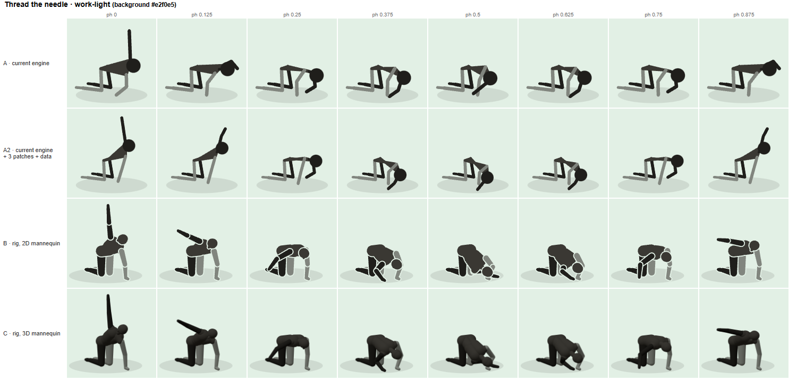
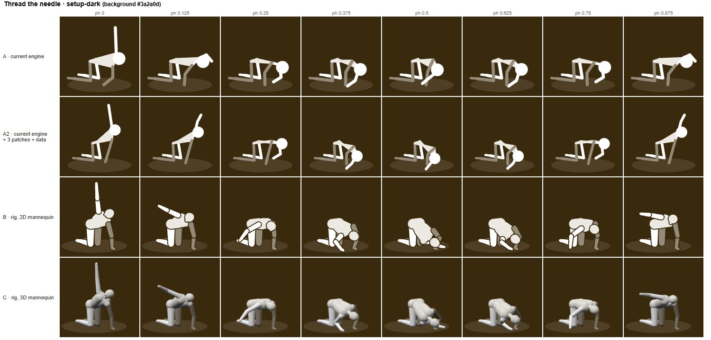
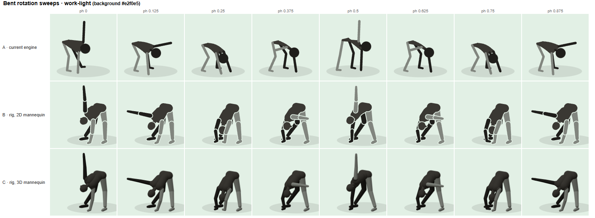
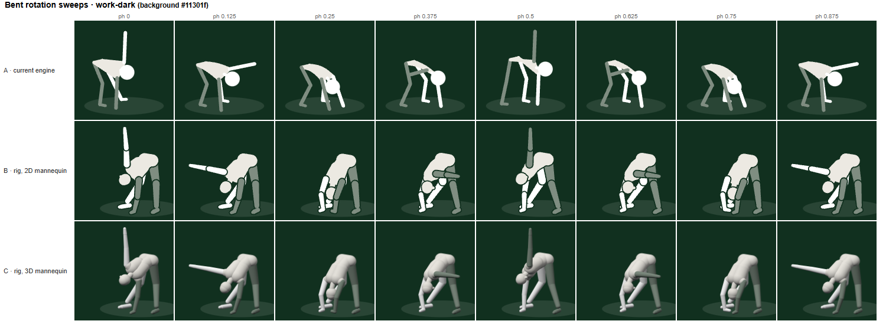
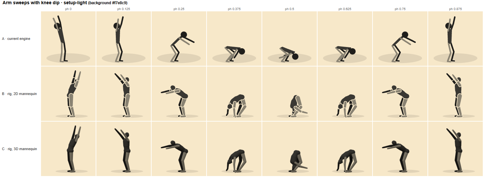
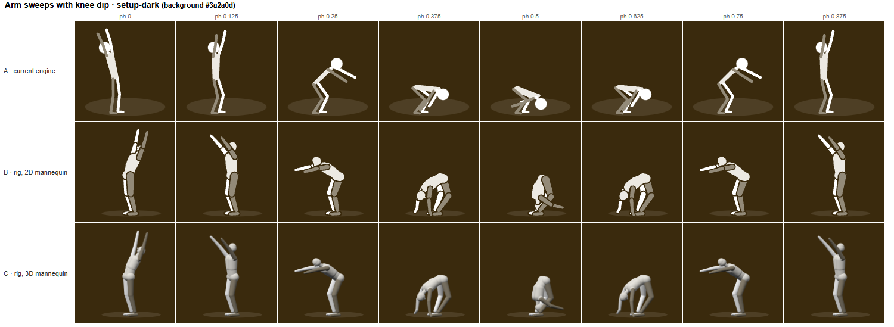
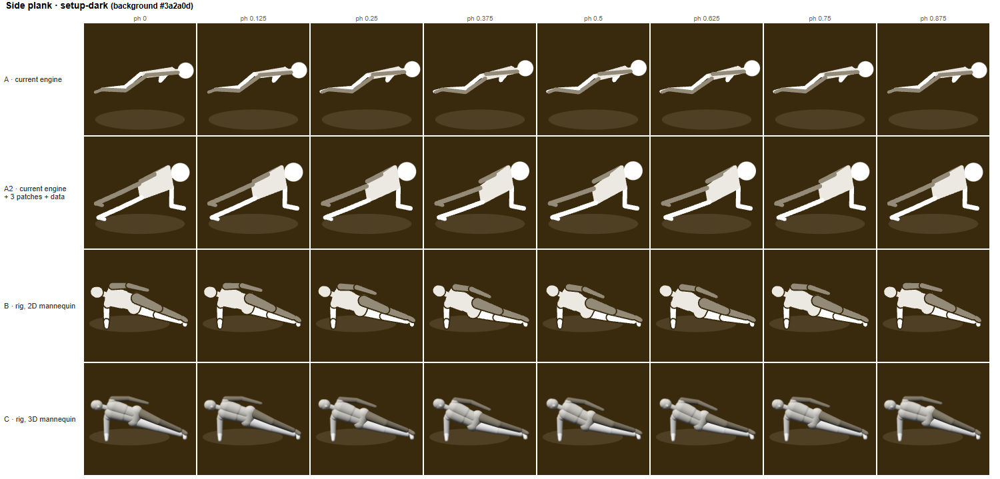
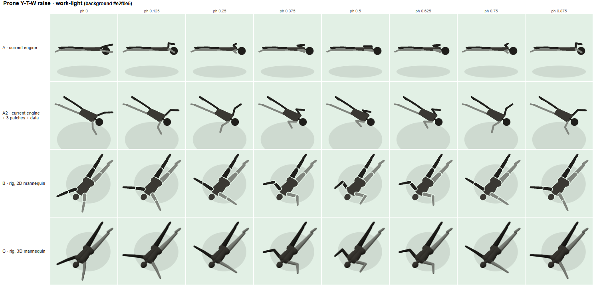
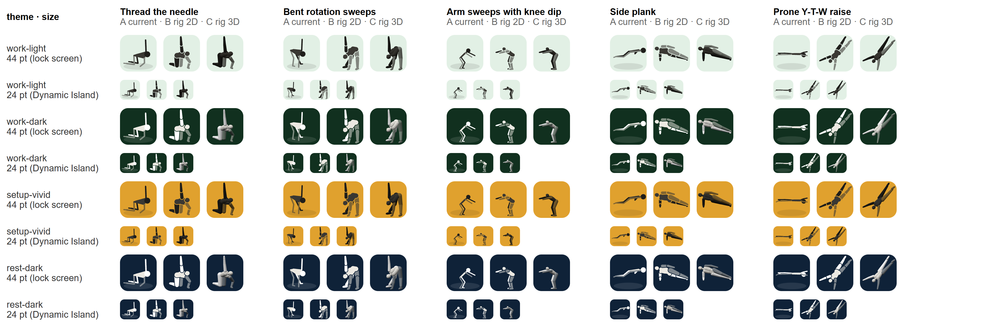
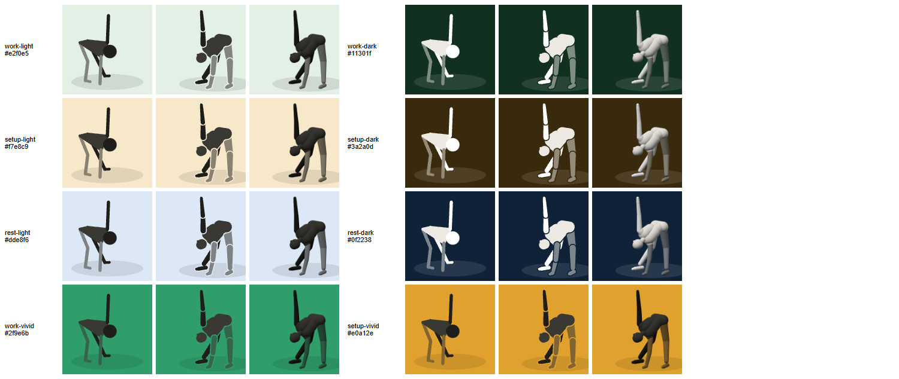

# Figure system assessment

2026-11-12, branch `figure-assessment`. Phase 1 of `docs/pose-audit-plan.md`. Nothing in
the shipped apps was touched. Scope: Morning Flow, Daily 13, Strength (37 movements).

## Recommendation

**Improve the engine in place. Do not rebuild it, and do not change medium.**

1. Put the audit into the gauntlet now: rubric checklists, eight-phase sheets and the
   numeric checks. This is what gets errors found before Will sees them, and it does not
   depend on any other decision.
2. Patch the current engine with four small changes: root roll, per-movement camera
   pitch, no forced stop at mid keyframes, and a floor clamp. Then fix the data faults in
   the critique, app by app, with the rubrics as the acceptance test.
3. Keep the stick figure as the skin for now. Recolour it from the phase background by
   one rule (shown below). Pre-render one still per movement for the Live Activity.
4. Re-run the audit. Only if movements still fail for engine reasons, revisit the rig
   prototype in `proto/rig/`, which stays on this branch as a worked fallback.

This is not what I set out to recommend. My draft said "rebuild as a constraint rig with
a 2D mannequin skin". The independent reviewer argued that I had never tested the cheap
path, so I built it as a control, and it won. The section "What changed my mind" has the
evidence.

## Is a stick figure the right medium?

Judged against video and 3D bodies on the same criteria, a programmatic figure is the
right medium for this app. The reasons are specific to this app, not general.

- **The lock screen takes a still, whatever the medium.** Live Activities are SwiftUI
  only, animations cap at two seconds and fire on state change, and state is limited to
  4 KB (Apple docs, in `docs/research/figure-media-landscape.md` section 2). Every
  candidate ends up as one static image per movement there.
- **The background changes colour by phase.** A drawn figure takes any colour. Video has
  a baked background; the only transparent format on iOS is HEVC with alpha, which is
  encoded on a Mac and is untested in a WKWebView.
- **Thirteen of the movements are Will's own variants.** The research found no licensed
  library that lists qi-gong-style mobility or hip CARs. They would have to be filmed.
- **The evidence does not favour realism.** Small studies find no reliable learning
  difference between video, stick figures and point-light figures. Motion beats stills
  (d = 1.06 for motor procedures). No study was found on muscle highlighting or
  rotatable cameras.
- **Correctness has to be checkable by the author.** Claude can render and measure a
  programmatic figure headlessly on this Windows machine. It cannot review footage for
  form, and cannot build or run a native 3D view without a Mac.

What video does better: it is correct by construction if the person filmed moves
correctly, and it shows hands, feet and grip, which the stick figure cannot. If Will
wants to test it, the honest test is one filmed loop with alpha on his phone. I did not
do that test, so video is not rejected on evidence, only on fit.

## The current poses

Full detail in `docs/pose-critique.md`. Sheets for all 37 movements are in
`proto/audit/out/current/`, numeric flags in `proto/audit/out/checks.md`.

| | Count |
|---|---|
| Pass with cosmetic notes | 10 |
| Recognisable, but a rubric line fails | 19 |
| Wrong or unreadable to someone who knows the movement | 8 |

The eight: Thread the needle, 90/90 with a fold, Side-lying clamshell, Prone Y-T-W,
Side plank (Daily and Strength), Face pull, Band pull-apart.

About 28 movements need keyframe or camera edits only. Six need an engine change: Side
plank twice and Clamshell cannot lie on their side because the root has no roll, and
Y-T-W, 90/90 and Floor press lie in the floor plane, which a camera fixed at 13° of
pitch flattens. Feet are the remaining engine gap (heel-up cannot be authored and the
foot flips direction in four movements).

None of the faults were caught by `npm run gauntlet`. All the numeric ones were caught by
about 80 lines of new checks.

## Candidates compared

Scores are my judgement after the prototypes and the review: ++ strong, + adequate,
− weak, −− blocking. "Verify" means whether Claude can author it and prove it right.

| Candidate | Pose correctness | Phone and thumbnail read | Any phase colour, light and dark | Cost per movement | Verify | Battery | Fit with Capacitor | Migration |
|---|---|---|---|---|---|---|---|---|
| Keep, fix data only | − six movements stay wrong | + | ++ | low | ++ | ++ | ++ | none |
| **Improve engine in place** | + (feet still weak) | + | ++ | low | ++ | ++ | ++ | small; all data and QA carry over |
| Rebuild as constraint rig, JS | + | + open poses, − folded | ++ | medium | ++ | ++ | ++ | large: 37 movements, props, orbits, QA re-bound |
| 3D mannequin in three.js | + | − at 24 pt | + needs lighting per theme | medium | + (headless WebGL works) | unmeasured | + | large, same rig work plus a renderer |
| Native 3D (RealityKit) | + | − at 24 pt | + | high | −− no Mac, cannot run it here | unmeasured | − native view under a web view | very large |
| Rive | − 2D only, no camera | + | ++ | medium | + has a text format and CLI | + | + (3.3 MB runtime) | very large, new toolchain |
| Keyframes from pose estimation | − weak on floor poses, depth untested | n/a (feeds a rig) | n/a | high | − needs clean footage first | n/a | n/a | needs filming anyway |
| Real video, self-recorded | ++ if performed well | ++ full screen, + thumbnail as frame grab | −− baked background, alpha untested | high: reshoot to change anything | −− Claude cannot judge form on footage | + | + | everything discarded |
| Licensed video or 3D library | + for Strength only | ++ | −− | low per clip, price by quote | − | + | + | 13 Flow movements not covered |

Notes on the rows that were close:

- **SceneKit is soft-deprecated** (WWDC25: "not recommended" for new apps). Native 3D
  means RealityKit, a Swift widget extension is needed for the Live Activity either way,
  and all of it needs a Mac.
- **Rive** should be rejected because it is 2D with no camera, not because it is hard to
  author. The research found a text format and a headless CLI.
- **Strong video-to-3D models are closed to commercial use** (SMPL licence). MediaPipe is
  usable, but its accuracy depends on view angle and was never validated on floor poses.
- **AI video** failed 36 of 36 prompted movements in a January 2026 test.

## Prototypes

All strips are regenerated by `node proto/compare.js`. Rows:

- **A** current engine, shipped poses, recoloured for the theme.
- **A2** the control: current engine with three text patches and data-only fixes
  (`proto/patched/engine.js`).
- **B** new rig (`proto/rig/rig.js`) drawn as a 2D volume mannequin in SVG.
- **C** the same rig drawn as a lit 3D mannequin in three.js.

The phase colours are placeholders, because the redesign's palette does not exist yet.

Thread the needle, work phase, light:

Thread the needle, setup phase, dark:

Bent rotation sweeps, work phase, light and dark (no control row: its faults are data
and camera, which the rig did not fix either):

Arm sweeps with knee dip, setup phase, light and dark:

Side plank, which the current engine can only fake:

Prone Y-T-W with a raised camera:

Live Activity sizes. The PNG is 3x, so view it at a third for true size:

One pose on eight backgrounds, with one rule choosing the figure colours:

The other strips (each movement on work-light, work-dark, setup-light, setup-dark) are
in `proto/out/`.

### What the strips show

- **A2 is the best row for Thread the needle.** Support arm straight in the reach (177°),
  shoulder and head down to the floor in the thread, and the two arms stay distinct. It
  took four changed numbers.
- **A2 makes a true side plank** with one new pose number (`roll`). Hips are stacked
  (9.8 units apart in height), the shoulder is over the elbow.
- **The mannequin is clearer in open poses and worse in folded ones.** In B and C, Thread
  at 0.375 to 0.625 and the both-hands-down frame of the windmill stack torso, head, arm
  and knee into one mass. Thin lines occlude less.
- **At 24 pt the stick figure reads best.** B becomes a blob with outline fragments, C a
  silhouette.
- **The 3D row adds shading and nothing else at these sizes.** Its real advantage, a
  camera the user can rotate, was not prototyped.
- **My rig's fold for Arm sweeps is too extreme** (a pike, wrists 45 cm behind the
  ankles) and its range checks passed it. A rig does not prevent authoring errors.

### Legibility on phase colours

One rule picks a dark or light figure by whichever contrasts more with the background,
and derives the left-limb tone by mixing toward the background. Contrast ratios
(`proto/out/contrast.md`):

| Background | Torso | Right limbs | Left limbs |
|---|---|---|---|
| Pale (three tested) | 9.5 to 9.9 | 13.5 to 14.2 | 3.1 to 3.2 |
| Dark (three tested) | 11.4 to 13.3 | 13.8 to 16.1 | 4.1 to 4.3 |
| Saturated green #2f9e6b | 3.5 | 4.9 | 2.0 |
| Saturated amber #e0a12e | 5.2 | 7.4 | 2.5 |

Pale and dark phase colours work. Saturated mid-tones do not: the lighter left limbs
fall below 3:1 and the far leg nearly disappears. Either the redesign avoids mid-tone
phase colours behind the figure, or left and right must be told apart some other way
than tone (an outline, or a pattern). This applies to every skin equally.

## What changed my mind

The reviewer's report is `docs/review-figure-assessment.md`. Its objections, and what I
did about each:

| Objection | Answer |
|---|---|
| The audit is the real win, not the rig. | Agreed. It is now step 1 of the recommendation. |
| The critique over-classifies faults as "system". Cat-cows, Arm sweeps and most of Reverse lunges are data; the row's reversed knee is a wrong swivel. | Checked and agreed. Cat-cows holds its elbows at 177° all cycle with two changed spine pairs. The critique is revised and marks each changed score. |
| Arm sweeps and Knee drives were scored too harshly. | Agreed, both now severity 2. Bent-over row was scored too kindly, now 2. |
| The true system list is three or four patches to a 158-line engine, and that path was never prototyped. | This was the decisive point. I built it (row A2). Three text patches; 20 of 26 Flow and Daily movements stay byte-identical, and the six that differ are exactly those with a mid keyframe. |
| The rig repeats the bent support arm it was built to cure, and its self-checks said nothing. | Confirmed: 109°. I fixed the pose (now 164°). The wider point stands: range checks do not test rubric lines. Rubric items have to become per-movement assertions, as `qa/daily.js` already does for a few. |
| The mannequin is worse in folded poses and at 24 pt. | Agreed from the strips. The skin recommendation is now the stick figure. |
| Side plank's forearm points at the lens and the sag is invisible; Y-T-W uses the overhead camera Will already rejected. | Agreed on side plank. On Y-T-W: Will rejected losing the prone read. A2 uses pitch 58, which is a trade for him to judge on a phone, listed under "Needs Will". I am not treating it as settled. |
| Five movements authored by the rig's own builder is thin evidence; no props, orbits or passing movements. | Agreed. It is a reason not to rebuild on this evidence. |
| Video and three.js were dismissed without a device test. | Partly agreed. I state above that video is rejected on fit, not evidence, and name the test that would settle it. I did not run it: there is no footage and no Mac. |
| Licensed libraries were dismissed without a price. | Agreed that no price was obtained. They cannot cover Morning Flow, and mixing a licensed look for Strength with a drawn figure elsewhere is a design call for Will. |
| The prenatal apps mean two engines. | Under "improve in place" there is one engine. The patches are opt-in per movement. |

Where I still disagree with the reviewer: it rates the rig as over-engineered, but the
current schema did cost me a numeric search for the side plank's elbow swivel in the
control, the same hand-fitting the repo's notes complain about. That cost is real. It is
not large enough to justify re-authoring 37 movements.

## Effort

These are estimates in working sessions of roughly this one's size, not measurements.

| Path | Work | Estimate |
|---|---|---|
| Keep and fix | Data and camera fixes for about 28 movements. Six stay wrong. | 2 to 3 sessions |
| **Improve (recommended)** | Audit into the gauntlet; four engine patches in `eng2.js`, `app_tpl.js`, `wk_tpl.js`; rubric assertions; data fixes per app with a fresh reviewer each; byte-identical diff for untouched movements; a swivel-fitting helper. | 5 to 7 sessions |
| Improve, then feet | Authored foot contact (flat, heel-up) in the engine. | 1 to 2 more |
| Rebuild as rig | Finish the rig, port props, orbits, mirroring and both templates, re-author 37 movements, re-bind three QA suites. | 12 to 18 sessions |
| Native 3D | The rig work, plus a RealityKit renderer and a Mac build loop Claude cannot run. | not estimable from here |
| Video | Will films 37 loops, edits, encodes HEVC alpha on a Mac; a still set for the lock screen; reshoot to change anything. | days of Will's time, per the research, plus an unproven background test |

Measured: the current renderer takes 0.03 ms per frame in Node and the rig's SVG
renderer 0.05 ms, so neither is a performance concern. No battery or frame-rate figures
exist for three.js in a WKWebView.

## What carries over

Under the recommended path, everything: pose data, props, orbits, both templates, the
gauntlet, the cue system. From this branch: the rubrics, the audit tools
(`proto/audit/`), the camera fitter idea (`proto/rig/camfit.js`, an aid that ranks
views, not a judge), the theme rule, and the still-rendering route for the Live Activity.

## Limits of this assessment

- Judged on still strips, not on loops on a phone. Timing faults (the stop at M) were
  found numerically, not seen.
- The phase colours are invented. Only eight backgrounds were tested.
- Video, native 3D, Rive and pose estimation were assessed from research, not built.
- The rig prototype has no props, orbits or bilateral switch.
- The control re-authored four movements, not all six that need an engine change:
  Clamshell and 90/90 were not attempted, and the foot faults are untouched.
- The strips show one camera per movement. Thumbnails show one chosen phase each.
- Many rubric sources were read only as abstracts or search summaries; each rubric file
  marks which.

## Needs Will

The decision: **keep and fix, improve (recommended), or rebuild.** Then, whichever is
chosen:

1. Y-T-W camera: side-on (prone reads, letters do not) or raised to about 58° (letters
   read, the lift off the floor does not). Row A2 in the Y-T-W strip shows the raised one.
2. Deep squats: the cue says "almost sitting on your heels", the figure stops at
   parallel. Which is right?
3. Cat-cows: confirm "elbows locking the movement out" means arms straight and vertical
   with the shoulders free.
4. Plank hold: the spec says forearm plank, the spoken setup says "Elbows or hands". The
   figure should show one. Changing the spoken line needs a new clip.
5. Side plank: the loop animates the sag, which is the fault. Keep it, or hold the line?
6. Bent-over row: is "hinge 45 to 60°" measured from vertical or horizontal?
7. Phase colours: can the redesign keep saturated mid-tones out from behind the figure?
8. Whether to film one test loop to settle the video question on evidence.
